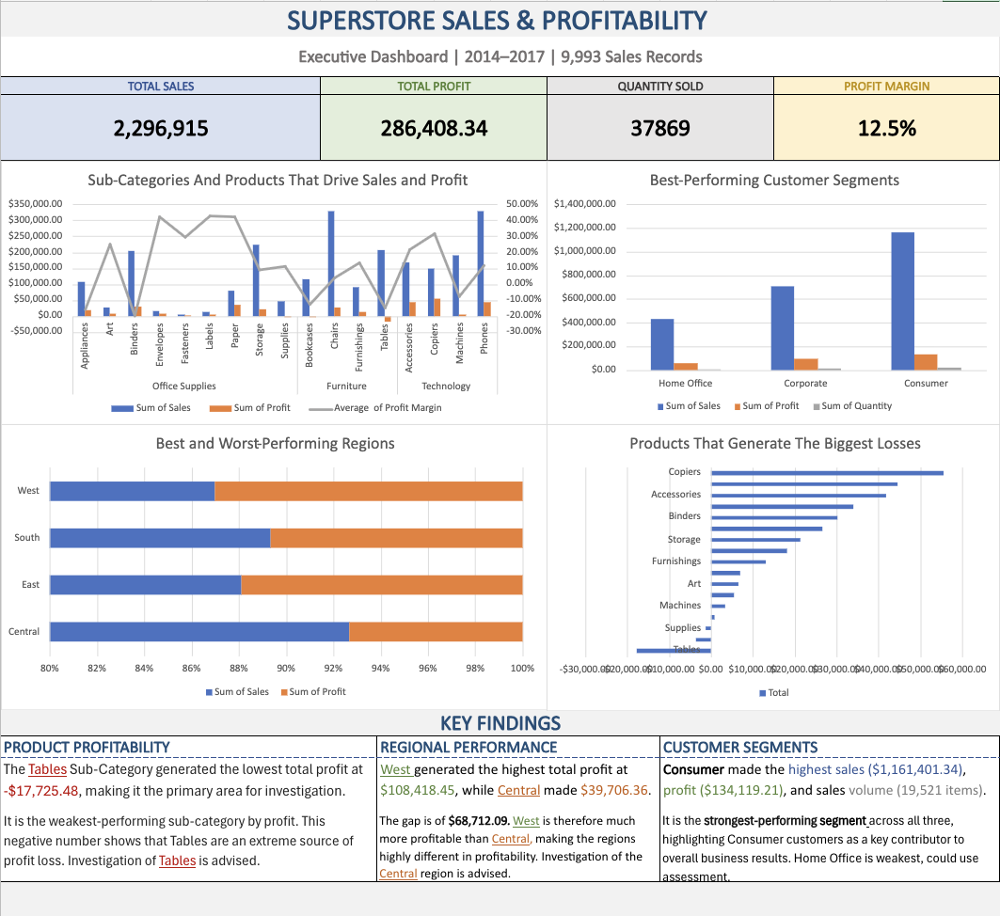

# Superstore Sales Analysis | Microsoft Excel

## Project Overview

End-to-end 9994-row sales data analysis using only Microsoft Excel(web version), including Data Cleaning, Exploratory Analysis, Pivot Tables, and a complete interactive dashboard with slicers, key findings, visual charts and KPIs.
This project demonstrates: raw data exploration, data cleaning performance and preparation, and transformation of the manipulated dataset into meaningful business insights through analytical skills and dashboard visualization.

## Dashboard Preview

## Tools & Techniques
- Microsoft Excel
- Data Cleaning and Preparation
- Pivot Tables and Pivot Charts
- Exploratory Data Analysis
- Data Aggregation
- Data Visualization
- Custom Dashboard Development via Excel

## Project Structure

The workbook contains the following worksheets:

- Raw Data : Original, unmodified sales dataset 
- Clean Data : Cleaned dataset with some calculations 
- Analysis 1-3(chronological) : Analytical PivotTables, aggregations and findings 
- Dashboard : Visual representation, an all-encompassing report 

## Analysis Process
**1. Data Preparation**
Reviewed and cleaned the original ~10k-row dataset to prepare it for proper analysis. 

**2. Data Analysis**
Looked into sales performance, product categories, and other relevant business indicators.

**3. Data Aggregation**
Explored multiple Pivot Tables and Pivot Charts to summarize and compare the information.

**4. Dashboard Development**
Combined Charts and key findings into a visual dashboard for interpretation.

## Screenshots

### Original Dataset

Source: [Superstore Sales Dataset](https://www.mathewkanalytics.com/datasets/superstore-sales/)

### Cleaned Dataset

### Analysis

## Project Files

The complete Excel workbook is available in this repository:

`Superstore_Sales_Analysis.xlsx`

It contains the original dataset, cleaned dataset, analytical worksheets, Pivot Tables, charts, and dashboard.
